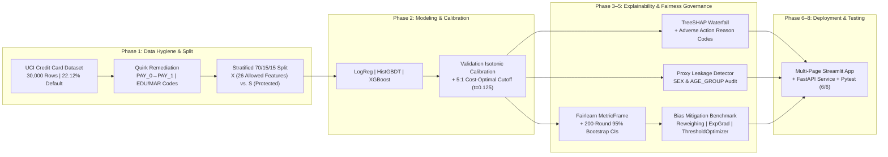

# ⚖️ Credit Risk Explainability & Fairness Auditing Suite

[](https://www.python.org/)
[](https://xgboost.readthedocs.io/)
[](https://shap.readthedocs.io/)
[](https://fairlearn.org/)
[](https://streamlit.io/)
[](https://fastapi.tiangolo.com/)
[](tests/test_creditfair.py)

> **⚠️ Educational & Regulatory Disclaimer:** This repository is an **educational engineering portfolio project** simulating the regulator-facing explainability, probability calibration, and algorithmic fairness auditing pipeline used in consumer credit risk. It is trained on the historical 2005 UCI Taiwan Credit Card Default dataset ($N = 30,000$) and **must never be used for real-world credit underwriting or lending decisions**. Nothing in this repository constitutes legal or regulatory compliance advice.

---

## 📌 Executive Summary & Headline Findings

In regulated consumer lending, maximizing ROC-AUC is only the starting point. Under frameworks such as the **US Equal Credit Opportunity Act (ECOA / Regulation B)**, **EU GDPR Article 22 / EU AI Act**, and **RBI Digital Lending Guidelines**, credit risk models must provide **individual Adverse Action explanations**, **calibrated default probabilities**, and **empirical fairness audits across protected demographic subgroups**.

This end-to-end suite builds a leakage-free credit default pipeline and wraps it in a three-pillar governance layer:

- **1. Credit-Industry Ranking & Probability Calibration:** Regularized **XGBoost** achieves **Test ROC-AUC = `0.7830`**, **Gini = `0.5660`**, and **KS Statistic = `0.4346`** on the held-out test set ($N = 4,500$). Post-hoc **Isotonic Regression calibration** fitted on the validation split reduces the **Brier Score from `0.1794` to `0.1343` (-25.1%)**.
- **2. Cost-Sensitive Decision Thresholding:** Under a **5:1 False-Negative (missed default) to False-Positive (wrongful denial) cost matrix**, optimizing the cutoff on the validation set shifts the decision threshold from $0.50$ to **$t^* = 0.1250$**, reducing expected business cost per applicant by **31.5%** (`0.7820` $\rightarrow$ `0.5356`).
- **3. Adverse Action Reason Codes & Stability:** Exact `TreeSHAP` log-odds decomposition translates every prediction into plain-English **Top-4 Adverse Action Reason Codes**, achieving **$k=5$ nearest-neighbor explanation stability of `0.6300` Spearman correlation** and **`59.3%` Top-4 Jaccard overlap**.
- **4. Empirical Proof Against "Fairness Through Unawareness":** Even with `SEX`, `AGE`, and `MARRIAGE` strictly excluded from the model feature matrix `X`, diagnostic proxy classifiers trained only on allowed financial features (`LIMIT_BAL`, `EDUCATION`, and 6-month bill/payment histories) predict **`SEX` with ROC-AUC = `0.6166`** and **`AGE_GROUP` with Macro ROC-AUC = `0.6393`**.
- **5. Algorithmic Bias Mitigation Across 3 Paradigms:** Benchmarks **Pre-processing (Kamiran & Calders Sample Reweighing)**, **In-processing (`ExponentiatedGradient` with Demographic Parity & Equalized Odds)**, and **Post-processing (`ThresholdOptimizer`)** with 200-round **95% bootstrap confidence intervals**, highlighting the legal distinction between **Disparate Impact** and **Disparate Treatment**.

---

## 🏗️ System Architecture



---

## 🧹 1. Dataset Hygiene, Quirks Fixed & Demographic Base Rates

The dataset is the UCI **Default of Credit Card Clients** ($N = 30,000$ Taiwanese credit card holders, April–September 2005). Before modeling, three well-known dataset anomalies are programmatically cleaned in [`src/creditfair/data.py`](src/creditfair/data.py):

1. **Column Alignment (`PAY_0` $\rightarrow$ `PAY_1`):** The raw UCI schema jumps from `PAY_0` (Month 1 / September status) to `PAY_2` (Month 2 / August status). Renamed `PAY_0` $\rightarrow$ `PAY_1` so `PAY_1..PAY_6` align with `BILL_AMT1..6` and `PAY_AMT1..6`.
2. **Undocumented `EDUCATION` Codes (`0, 5, 6` $\rightarrow$ `4`):** Remapped **345 records** with undocumented codes into category `4` (*Others*).
3. **Undocumented `MARRIAGE` Code (`0` $\rightarrow$ `3`):** Remapped **54 records** with code `0` into category `3` (*Others*).
4. **Protected Attribute Isolation:** `SEX`, `AGE`, `AGE_GROUP` (`21-29`, `30-39`, `40-49`, `50+`), and `MARRIAGE` are removed from `X` before training and stored in parallel audit frames (`S_train`, `S_val`, `S_test`).

### Observed Base Default Rates by Protected Subgroup ($N = 30,000$)

| Protected Attribute | Subgroup | Sample Count ($N$) | Observed Base Default Rate |
| :--- | :--- | :---: | :---: |
| **SEX** | Female | `18,112` | `20.78%` |
| **SEX** | Male | `11,888` | `24.17%` |
| **AGE_GROUP** | `21-29` | `9,618` | `22.84%` |
| **AGE_GROUP** | `30-39` | `11,238` | `20.25%` |
| **AGE_GROUP** | `40-49` | `6,464` | `22.97%` |
| **AGE_GROUP** | `50+` | `2,680` | `25.30%` |
| **MARRIAGE** | Married | `13,659` | `23.47%` |
| **MARRIAGE** | Single | `15,964` | `20.93%` |
| **MARRIAGE** | Others | `377` | `23.61%` |

> **Why Base Rates Matter (The Fairness Impossibility Theorem):** Because Male applicants (`24.17%`) and `50+` borrowers (`25.30%`) have higher historical default rates than Female (`20.78%`) and `30-39` (`20.25%`) borrowers, the **Chouldechova (2017) & Kleinberg et al. (2016) Impossibility Theorem** proves that no well-calibrated model can simultaneously satisfy **Demographic Parity** (equal denial rates) and **Equalized Odds** (equal TPR & FPR) across groups.

---

## 📈 2. Model Benchmark, Credit-Industry Metrics (KS, Gini) & Calibration

All models are evaluated **once** on the held-out test set ($N = 4,500$) using the validation-optimized decision cutoff **$t^* = 0.1250$**:

| Model | ROC-AUC $\uparrow$ | PR-AUC $\uparrow$ | Gini ($2\cdot\text{AUC}-1$) $\uparrow$ | KS Statistic $\uparrow$ | Brier Score $\downarrow$ | Accuracy | F1 Score | Recall (TPR) | FPR |
| :--- | :---: | :---: | :---: | :---: | :---: | :---: | :---: | :---: | :---: |
| **Logistic Regression (Scaled)** | `0.7492` | `0.4969` | `0.4984` | `0.4007` | `0.1429` | `0.5424` | `0.4428` | `0.8213` | `0.5368` |
| **HistGradientBoosting** | `0.7770` | `0.5554` | `0.5541` | `0.4192` | `0.1353` | `0.5564` | `0.4573` | `0.8444` | `0.5254` |
| **XGBoost (Weighted, Uncalibrated)** | `0.7811` | `0.5606` | `0.5623` | `0.4268` | `0.1794` | `0.7502` | `0.5321` | `0.6416` | `0.2189` |
| **XGBoost (Isotonic Calibrated — Primary)** | **`0.7830`** | **`0.5515`** | **`0.5660`** | **`0.4346`** | **`0.1343`** | **`0.6109`** | **`0.4815`** | **`0.8163`** | **`0.4475`** |

- **Why Probability Calibration Matters:** Uncalibrated class-weighted XGBoost achieves strong ranking (`ROC-AUC = 0.7811`), but `scale_pos_weight` inflates predicted probabilities (`Brier = 0.1794`). Wrapping the model with validation-set **Isotonic Regression** lowers the Brier score to **`0.1343`** so predicted scores represent true empirical default probabilities.

---

## 🔍 3. Explainability: TreeSHAP, Adverse Action Notices & Proxy Leakage Audit

### 3.1 Top Global Features by Mean `|SHAP|` (Log-Odds Impact)

| Rank | Feature | Domain Description | Mean `|SHAP|` |
| :---: | :--- | :--- | :---: |
| 1 | `MAX_DELINQUENCY_6M` | Worst repayment delay (months late) over past 6 months | `0.3567` |
| 2 | `PAY_1` | Repayment status in most recent month (Month 1 / Sept) | `0.3019` |
| 3 | `MONTHS_DELINQUENT_6M` | Total number of months with late payment in past 6 months | `0.1716` |
| 4 | `UTILIZATION_RATIO_1` | Recent credit line utilization ratio (Bill 1 / Credit Limit) | `0.1064` |
| 5 | `LIMIT_BAL` | Credit limit amount (NT$) | `0.0891` |
| 6 | `BILL_AMT1` | Bill statement balance in most recent month (NT$) | `0.0871` |

### 3.2 Sample Individual Adverse Action Notice (from `artifacts/explainability_summary.json`)
- **Predicted Default Probability:** `19.26%` (Cutoff $t^* = 12.50%$) $\rightarrow$ **Decision: `DENY`**

| Principal Reason Rank | Feature Code | SHAP Contribution (Log-Odds) | Plain-English Adverse Action Reason Code |
| :---: | :--- | :---: | :--- |
| `1` | `MAX_DELINQUENCY_6M` | `+0.5076` | Peak delinquency of 2 month(s) past due over the last 6 months (increased default risk) |
| `2` | `LIMIT_BAL` | `+0.0920` | Assigned credit limit of NT$50,000 (increased default risk) |
| `3` | `BILL_AMT1` | `+0.0611` | Bill statement balance of NT$1,310 in Month 1 (increased default risk) |
| `4` | `PAY_AMT5` | `+0.0308` | Repayment amount of NT$587 in Month 5 (increased default risk) |

### 3.3 Explanation Stability & Demographic Proxy Leakage
- **Local Explanation Stability ($k=5$ Nearest Neighbors across $N=50$ test applicants):**
  - Mean pairwise **Spearman rank correlation** of SHAP vectors: **`0.6300`** ($\pm 0.2001$)
  - Mean **Top-4 Adverse Reason Jaccard similarity**: **`59.3%`**
- **Proxy Leakage Audit ("Fairness Through Unawareness" Test):**
  - Can an auditor reconstruct stripped protected attributes solely from the 26 allowed financial features?
  - **`SEX` Proxy Classifier:** Achieves **ROC-AUC = `0.6166`** (vs. `0.5000` random chance), driven by `LIMIT_BAL`, `EDUCATION`, and `BILL_AMT6`.
  - **`AGE_GROUP` Proxy Classifier:** Achieves **Macro OvR ROC-AUC = `0.6393`** (vs. `0.5000` random chance), driven by `LIMIT_BAL` (`0.1569`) and `EDUCATION` (`0.1544`).

---

## ⚖️ 4. Subgroup Fairness Audit (`Fairlearn MetricFrame` & 95% Bootstrap CIs)

### 4.1 Disaggregated Test-Set Audit by `SEX` ($t^* = 0.1250$)
| Subgroup | $N$ | Base Default Rate | Denial Rate (Selection) | Approval Rate | TPR (Recall) | FPR (Wrongful Denial) | Precision | Accuracy |
| :--- | :---: | :---: | :---: | :---: | :---: | :---: | :---: | :---: |
| **Female** | `2,734` | `20.04%` | `51.32%` | `48.68%` | `0.8303` | `0.4337` | `0.3243` | `0.6192` |
| **Male** | `1,766` | `25.37%` | `55.38%` | `44.62%` | `0.7991` | `0.4704` | `0.3661` | `0.5980` |

- **Demographic Parity Difference:** `0.0406` (95% Bootstrap CI: `[0.0094, 0.0706]`)
- **Equalized Odds Difference:** `0.0367` (95% Bootstrap CI: `[0.0173, 0.0820]`)
- **Disparate Impact Ratio (Approval):** `0.9165` (95% Bootstrap CI: `[0.8570, 0.9796]`) — **Passes 80% Four-Fifths Rule** ✅

### 4.2 Disaggregated Test-Set Audit by `AGE_GROUP` ($t^* = 0.1250$)
| Subgroup | $N$ | Base Default Rate | Denial Rate (Selection) | Approval Rate | TPR (Recall) | FPR (Wrongful Denial) | Precision | Accuracy |
| :--- | :---: | :---: | :---: | :---: | :---: | :---: | :---: | :---: |
| **21-29** | `1,414` | `22.21%` | `56.36%` | `43.64%` | `0.8567` | `0.4800` | `0.3375` | `0.5948` |
| **30-39** | `1,700` | `20.24%` | `49.53%` | `50.47%` | `0.8081` | `0.4159` | `0.3302` | `0.6294` |
| **40-49** | `975` | `22.67%` | `52.62%` | `47.38%` | `0.7919` | `0.4483` | `0.3411` | `0.6062` |
| **50+** | `411` | `28.47%` | `55.72%` | `44.28%` | `0.7778` | `0.4694` | `0.3974` | `0.6010` |

- **Demographic Parity Difference:** `0.0684` (95% Bootstrap CI: `[0.0442, 0.1157]`)
- **Equalized Odds Difference:** `0.0789` (95% Bootstrap CI: `[0.0551, 0.1636]`)
- **Disparate Impact Ratio (Approval):** `0.8646` (95% Bootstrap CI: `[0.7763, 0.9078]`)

---

## 🛠️ 5. Algorithmic Bias Mitigation & The Legal/Accuracy Trade-Off

We benchmark three distinct intervention families in [`src/creditfair/mitigate.py`](src/creditfair/mitigate.py):
1. **Pre-Processing — Sample Reweighing (Kamiran & Calders, 2012):** Assigns inverse joint-probability weights $w(s, y) = \frac{P(S=s)P(Y=y)}{P(S=s, Y=y)}$ during XGBoost training.
2. **In-Processing — `ExponentiatedGradient` (Agarwal et al., 2018):** Solves a Lagrangian saddle-point game enforcing `DemographicParity` or `EqualizedOdds`.
3. **Post-Processing — `ThresholdOptimizer` (Hardt et al., 2016):** Fits group-specific randomized probability thresholds on the validation split.

### 5.1 Mitigation Benchmark Across `SEX`
| Method | Paradigm | Protected Attr at Inference? | Accuracy | F1 | Expected Cost/App $\downarrow$ | DP Diff $\downarrow$ | Equalized Odds Diff $\downarrow$ | Approval DI Ratio |
| :--- | :---: | :---: | :---: | :---: | :---: | :---: | :---: | :---: |
| **Unmitigated Baseline (XGBoost)** | Baseline | No ✅ | `0.6109` | `0.4815` | `0.5518` | `0.0406` | `0.0367` | `0.9165` |
| **Pre-Processing: Sample Reweighing** | Pre-processing | No ✅ | `0.5700` | `0.4686` | `0.5571` | `0.0345` | `0.0312` | `0.9190` |
| **In-Processing: ExponentiatedGradient (Demographic Parity)** | In-processing | No ✅ | `0.7958` | `0.3316` | `0.8869` | `0.0096` | `0.0388` | `0.9896` |
| **In-Processing: ExponentiatedGradient (Equalized Odds)** | In-processing | No ✅ | `0.7940` | `0.3439` | `0.8753` | `0.0115` | `0.0337` | `0.9874` |
| **Post-Processing: ThresholdOptimizer (Demographic Parity)** | Post-processing | Yes ⚠️ | `0.8180` | `0.4356` | `0.7864` | `0.0070` | `0.0817` | `0.9922` |
| **Post-Processing: ThresholdOptimizer (Equalized Odds)** | Post-processing | Yes ⚠️ | `0.8189` | `0.4504` | `0.7696` | `0.0001` | `0.0740` | `0.9999` |

### 5.2 Mitigation Benchmark Across `AGE_GROUP`
| Method | Paradigm | Protected Attr at Inference? | Accuracy | F1 | Expected Cost/App $\downarrow$ | DP Diff $\downarrow$ | Equalized Odds Diff $\downarrow$ | Approval DI Ratio |
| :--- | :---: | :---: | :---: | :---: | :---: | :---: | :---: | :---: |
| **Unmitigated Baseline (XGBoost)** | Baseline | No ✅ | `0.6109` | `0.4815` | `0.5518` | `0.0684` | `0.0789` | `0.8646` |
| **Pre-Processing: Sample Reweighing** | Pre-processing | No ✅ | `0.5687` | `0.4672` | `0.5602` | `0.0809` | `0.0671` | `0.8185` |
| **In-Processing: ExponentiatedGradient (Demographic Parity)** | In-processing | No ✅ | `0.8029` | `0.3784` | `0.8424` | `0.0252` | `0.0528` | `0.9725` |
| **In-Processing: ExponentiatedGradient (Equalized Odds)** | In-processing | No ✅ | `0.8038` | `0.3804` | `0.8407` | `0.0253` | `0.0401` | `0.9725` |
| **Post-Processing: ThresholdOptimizer (Demographic Parity)** | Post-processing | Yes ⚠️ | `0.8178` | `0.4619` | `0.7547` | `0.0229` | `0.1001` | `0.9743` |
| **Post-Processing: ThresholdOptimizer (Equalized Odds)** | Post-processing | Yes ⚠️ | `0.8180` | `0.4212` | `0.8024` | `0.0349` | `0.1262` | `0.9622` |

> **⚖️ Disparate Impact vs. Disparate Treatment in Regulated Lending:** While `ThresholdOptimizer` reduces `SEX` Demographic Parity Difference to `0.0001`, it **requires passing the applicant's protected attribute at inference time** (`Protected Attr at Inference = Yes ⚠️`) to apply different credit score cutoffs by demographic group. Under US ECOA and EU non-discrimination law, applying explicitly different score cutoffs by sex or age constitutes **Disparate Treatment**. Consequently, **In-processing (`ExponentiatedGradient`)** and **Pre-processing (Sample Reweighing)** are preferred in production lending because they reduce disparities without using protected attributes at decision time.

---

## 🖥️ 6. Interactive Multi-Page Streamlit App & FastAPI Service

### Multi-Page Streamlit Dashboard (`app/`)
- **`app/Home.py` — Executive Overview & Calibration:** Interactive dataset quirk audit, model comparison table, reliability diagrams (calibration curves), and Kolmogorov-Smirnov separation plots.
- **`app/pages/1_Underwriter_View.py` — Underwriter Decision & Adverse Action Simulator:** Select any of the 4,500 held-out test applicants or adjust interactive *What-If* financial sliders, tune the FN:FP business cost slider, inspect the exact **SHAP Waterfall Plot**, and export a regulatory **Adverse Action Notice**.
- **`app/pages/2_Compliance_View.py` — Fairlearn Compliance & Mitigation Dashboard:** Interactive `MetricFrame` audit across `SEX`, `AGE_GROUP`, `MARRIAGE`, and `SEX x AGE_GROUP` with 95% bootstrap error bars, 80% Four-Fifths Rule compliance indicators, Proxy Leakage Audit charts, and the Accuracy-Fairness Pareto frontier.
- **`app/pages/3_Model_Card.py` — Model Governance Viewer:** Renders [`MODEL_CARD.md`](MODEL_CARD.md) alongside live JSON artifact inspector tabs.

### FastAPI REST Microservice (`api/main.py`)
Exposes three typed endpoints (`/health`, `/predict`, `/explain`). Example `/explain` response:
```json
{
  "default_probability": 0.1926,
  "threshold": 0.125,
  "decision": "DENY",
  "top_adverse_reasons": [
    {
      "rank": 1,
      "feature": "MAX_DELINQUENCY_6M",
      "shap_value": 0.5076,
      "reason_text": "Peak delinquency of 2 month(s) past due over the last 6 months (increased default risk)"
    }
  ]
}
```

---

## 📂 7. Repository Structure

```text
credit-risk-fairness-suite/
├── README.md                       # Project documentation (100% synced from artifacts/)
├── MODEL_CARD.md                   # Mitchell et al. (2019) Model Card
├── LEARNING_LOG.md                 # Phase-by-phase ML & regulatory engineering log
├── requirements.txt                # Pinned reproducible dependencies
├── pyproject.toml                  # Editable Python package & pytest configuration
├── Dockerfile                      # Production container for Render / Cloud Run
├── data/
│   ├── raw/                        # Gitignored; auto-downloaded UCI dataset
│   └── processed/                  # Stratified 70/15/15 train/val/test parquet splits
├── notebooks/
│   ├── 01_eda.ipynb                # Quirk cleaning, demographic base rates & leakage checks
│   ├── 02_baseline_models.ipynb    # LogReg, HistGBDT, XGBoost, KS/Gini, calibration & cost cutoff
│   ├── 03_explainability.ipynb     # Global/local SHAP, Adverse Action reasons & proxy leakage
│   └── 04_fairness_audit.ipynb     # Fairlearn MetricFrame, bootstrap CIs & mitigation trade-offs
├── src/creditfair/
│   ├── config.py                   # Paths, seeds, feature definitions & cost ratios
│   ├── data.py                     # Ingestion, quirk cleaning & stratified splitting
│   ├── features.py                 # Row-wise domain feature engineering
│   ├── train.py                    # Model training & validation Isotonic calibration
│   ├── evaluate.py                 # ROC-AUC, PR-AUC, KS, Gini, Brier & cost threshold
│   ├── explain.py                  # TreeSHAP, Adverse Action codes, stability & proxy audit
│   ├── fairness.py                 # MetricFrame subgroup audit & bootstrap 95% CIs
│   ├── mitigate.py                 # Reweighing, ExponentiatedGradient & ThresholdOptimizer
│   ├── report.py                   # End-to-end artifact generator
│   └── build_docs_and_notebooks.py # Programmatic doc & notebook synchronizer
├── artifacts/                      # Precomputed models, JSON metrics & SHAP parquet samples
├── app/
│   ├── Home.py                     # Executive overview & calibration dashboard
│   └── pages/
│       ├── 1_Underwriter_View.py   # Applicant simulator, SHAP waterfall & reason codes
│       ├── 2_Compliance_View.py    # MetricFrame, bootstrap CIs & mitigation dashboard
│       └── 3_Model_Card.py         # Interactive Model Card viewer
├── api/
│   └── main.py                     # FastAPI /predict, /explain, and /health service
└── tests/
    └── test_creditfair.py          # Pytest unit & API integration tests (6/6 passing)
```

---

## 🚀 8. Quickstart & Reproducibility

### 1. Clone & Install
```powershell
git clone https://github.com/ViditJain-05/credit-risk-fairness-suite.git
cd credit-risk-fairness-suite
python -m venv .venv
.\.venv\Scripts\Activate.ps1
pip install -r requirements.txt
pip install -e .
```

### 2. Launch the Multi-Page Streamlit App
```powershell
streamlit run app/Home.py
```

### 3. Launch the FastAPI Service
```powershell
uvicorn api.main:app --reload --port 8000
# Open Swagger UI at http://localhost:8000/docs
```

### 4. Run the Automated Test Suite (`pytest`)
```powershell
pytest -v
```

### 5. Regenerate All Data Splits, Models, Audits & Docs from Scratch
```powershell
python -m creditfair.report
python -m creditfair.build_docs_and_notebooks
```

### 6. Run with Docker
```bash
docker build -t credit-risk-fairness-suite .
docker run -p 8501:8501 credit-risk-fairness-suite
```

---

## ⚠️ 9. Honest Limitations & Scope Constraints
1. **Historical 2005 Taiwan Dataset:** Collected from a single Taiwanese bank in 2005 ($N = 30,000$). Macroeconomic conditions, inflation, and demographic base rates do not generalize to modern lending markets.
2. **Mathematical Impossibility of Simultaneous Fairness:** Because base default rates differ across sex and age brackets, no calibrated classifier can simultaneously satisfy Demographic Parity and Equalized Odds.
3. **Disparate Treatment Legal Constraint:** Post-processing (`ThresholdOptimizer`) requires protected attributes at inference time, which is restricted under fair-lending statutes; only pre-processing and in-processing operate without demographic inputs at prediction time.
